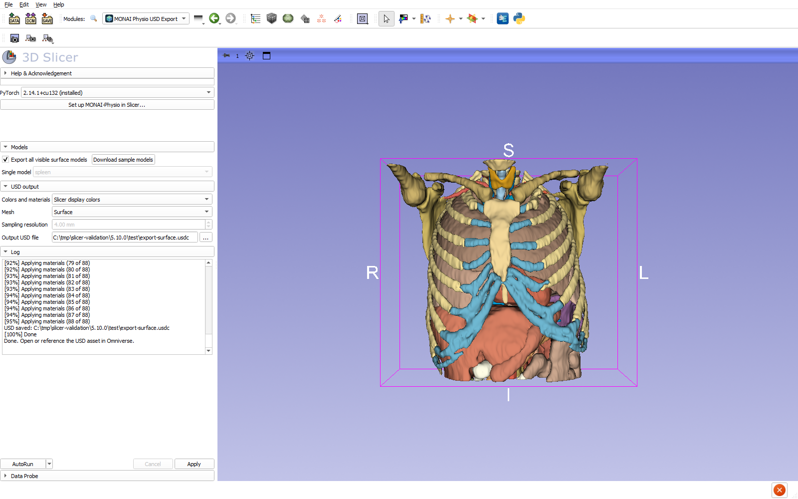
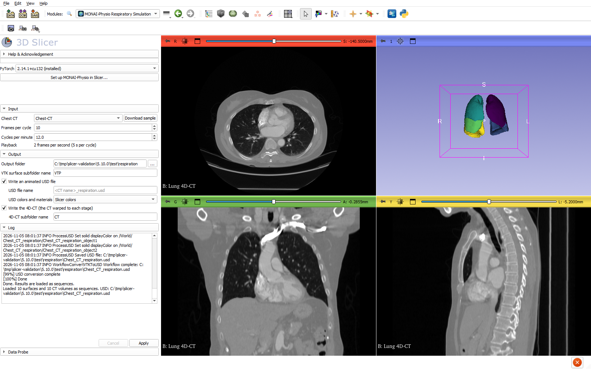

# MONAIPhysio: MONAI-Physio for 3D Slicer

**MONAIPhysio** is a 3D Slicer extension for simulating physiological motion
and connecting Slicer to NVIDIA Omniverse, built on
[MONAI-Physio](https://github.com/Project-MONAI/monai-physio). It holds two
modules, both in Slicer's **Simulation** category:

- **MONAI Physio USD Export** writes Slicer surface models, or tetrahedral or
  hexahedral volume meshes made from them, to an OpenUSD file, keeping
  geometry, placement and appearance, and can rewrite it as the scene changes.
- **MONAI-Physio Respiratory and Cardiac Simulation** predicts one breathing
  cycle of lung motion, or one heartbeat of heart motion, from a chest CT and
  loads the moving surfaces and the warped 4D-CT as Slicer sequences, with an
  animated USD for Omniverse.





**Status:** experimental. See [validation status](docs/VALIDATION.md) for the
Slicer releases, platforms and GPUs it has been tested on.
**License:** Apache License 2.0; see [LICENSE.txt](LICENSE.txt) and
[NOTICE.txt](NOTICE.txt) for retained Slicer-template attribution.
NV-Segment-CTMR, which the respiratory simulation downloads, has its own
non-commercial research license (see below).
**Maintainer:** [Stephen Aylward](https://github.com/aylward).
**Publication:** none yet.

## Requirements

| | USD Export: surface, hexahedra | USD Export: tetrahedra | Respiratory and Cardiac Simulation |
| --- | --- | --- | --- |
| Slicer | 5.10 or newer (Python 3.12) | same | same |
| PyTorch | installed by setup (CPU build is enough) | CUDA build | CUDA build |
| GPU | not needed | CUDA GPU | CUDA GPU with 16 GB or more (about 15 GB used in [validation](docs/VALIDATION.md)) |
| System memory | | | about 40 GB free, RAM plus page file, for a 512x512 chest CT (respiratory peak 37 GB, cardiac 24 GB) |
| Disk | several GB for the Python packages | same | plus about 1.4 GB of network weights |

PyTorch is always installed, because MONAI-Physio depends on it (and on
torch-scatter, torch-geometric and Warp). Slicer does not ship PyTorch. If a
PyTorch is already installed in Slicer, for example by the PyTorch extension,
setup keeps it when a prebuilt torch-scatter wheel exists for that build;
otherwise choose a build from the **PyTorch** menu. The GPU must be supported
by the PyTorch build: Blackwell / RTX 50 GPUs need CUDA 12.8 or newer. If you
only export surfaces, choose a CPU build: it is a much smaller download.

## Downloads and first run

Nothing is installed or downloaded when Slicer starts or the modules load.
Downloads happen only on these actions:

| Action | Downloads | From |
| --- | --- | --- |
| **Set up MONAI-Physio in Slicer...** (asks first) | PyTorch and torchvision, torch-scatter, MONAI-Physio and its dependencies: several GB | download.pytorch.org; data.pyg.org or this repository's [`Data` release](https://github.com/Project-MONAI/monai-physio-slicer/releases/tag/Data); PyPI |
| First **Apply** in Respiratory Simulation (asks first) | Pretrained lung-motion and registration networks, about 0.5 GB, into `~/.monai_physio/network_weights` | MONAI-Physio's model locations |
| same | NV-Segment-CTMR weights, about 870 MB, into the Hugging Face cache | Hugging Face |
| First cardiac **Apply** (asks first) | Pretrained Duke heart-motion network and heart shape model into `~/.monai_physio/network_weights` | MONAI-Physio's GitHub release |
| **Download sample models** / **Download sample** | Sample model scene (80 MB) / chest CT (89 MB), cached | this repository's `Data` release |

The first setup and the first respiratory simulation are therefore much
slower than later runs. Nothing is uploaded or sent anywhere.

## Installation

From Slicer's **Extensions Manager**, install **MONAIPhysio** and restart
Slicer. To run from source instead:

1. Download this repository and extract it.
2. In Slicer, add the **`MONAIPhysioExportUSD` and `MONAIPhysioRespiratorySimulation`
   directories** to **Edit > Application Settings > Modules >
   Additional module paths**, then restart Slicer.

Then:

1. Open **Simulation > MONAI Physio USD Export** or
   **Simulation > MONAI-Physio Respiratory and Cardiac Simulation**.
2. Pick a build in the **PyTorch** menu if needed (see Requirements) and click
   **Set up MONAI-Physio in Slicer...**. Setup uses Slicer's Python package
   manager and asks for confirmation before installing. Restart Slicer if
   packages were installed or changed. The modules need MONAI-Physio
   **2026.11.1** or newer; with an older version installed, Apply asks you to
   run setup, which upgrades it.
3. Work runs in Slicer's bundled `PythonSlicer`, using the same installed
   Python packages as Slicer while keeping the UI responsive.

Setup constrains Slicer's existing NumPy, VTK and other detected
numerical-library versions, so pip reports conflicts instead of upgrading
them. If Slicer's VTK/NumPy build is not identifiable through pip metadata,
setup refuses to install over it.

`torch-scatter` has no PyPI wheel, and building it from source needs a
compiler and a CUDA toolkit matching Slicer's PyTorch. Setup therefore
installs a prebuilt wheel for the chosen PyTorch: from PyTorch Geometric's
index (data.pyg.org) when it has one, otherwise, on Windows with Python 3.12,
from this extension's
[`Data` release](https://github.com/Project-MONAI/monai-physio-slicer/releases/tag/Data)
(PyTorch 2.12 with CUDA 13.0/13.2, and 2.13 and 2.14 with CPU, CUDA 13.0 and
13.2). The **PyTorch** menu marks builds that have no prebuilt torch-scatter.

## Export to USD

1. Load polygonal models in Slicer, or export a segmentation to models using
   Slicer's Segmentations module.
2. In **MONAI Physio USD Export**, the **Models** section exports every visible
   surface model by default. Uncheck **Export all visible surface models** to
   pick one model. Models that cannot be exported (lines, textures, ...) are
   skipped with a log message when exporting all. **Download sample models**
   adds a scene of 88 segmented chest and abdomen models (80 MB,
   checksum-verified and cached; also in the **Sample Data** module under
   **Simulation**) to the current scene.
3. In **USD output**, choose the colors and the mesh type (below) and the
   **Output USD file**
   (`...` opens a save dialog at the last saved file). Click **Apply** to write
   it; with no file set, Apply asks for one first.
4. Open the result in an Omniverse application, or add it as a USD reference.
   Exported stages use meters and Y-up. When referencing into a stage with other
   units or axes, apply the corresponding scale/orientation at the reference.

The stage holds every model as a sibling mesh under one level, with one camera
and one light, and materials shared under `/World/Looks`:

```
/World
  /SlicerModel/<model name>   one Mesh (or TetMesh) per model
  /Looks/<material>           SlicerMaterial, or one OmniSurface_<anatomy>
  /Camera, /DistantLight
```

**AutoRun** works like Slicer's CLI modules (e.g. Model Maker): while the
AutoRun button is down, the file is re-written after a short pause. Its menu
selects the triggers: **AutoRun on changed parameter** (models choice, colors,
mesh type, resolution, output file), **AutoRun on modified input** (a model, its display settings, its
transform, or the set of models changes), and **AutoRun cancels running
process** (otherwise a change during an export queues one more run). This
writes a file; it is not Live Sync into a running Omniverse app.

**Colors and materials** chooses how exported objects look:

- **Slicer display colors** (default) keeps each model's current Slicer color,
  scalar coloring, opacity and specularity, using USD Preview Surface. Models
  created from segmentations already carry Slicer's
  [GenericAnatomyColors](https://www.slicer.org/wiki/Slicer3:2010_GenericAnatomyColors)
  terminology colors.
- **MONAI-Physio anatomy materials** picks MONAI-Physio's anatomy entry from the
  model name (`Left Lung` matches `lung`, `left ventricle` matches
  `ventricle_left`; names are lower-cased and tried in both word orders) and
  binds its OmniSurface (MDL) material, with the display color set to that
  anatomy's color. Names with no material entry of their own use the group that
  MONAI-Physio's TotalSegmentator taxonomy gives the matching label (`left rib
  1` = `rib_left_1` -> bone, `L2 vertebra` = `vertebrae_L2` -> bone,
  `esophagus` -> soft tissue). Names that match nothing use the `other`
  material; the log lists each model's material and how it was found. The chosen
  entry is stored as `monai_physio:anatomy` custom data on each mesh. OmniSurface
  renders in Omniverse/RTX; Slicer opacity is kept only as the display opacity
  primvar.

**Mesh** chooses the geometry written for each model:

- **Surface** (default) writes the model's own polygons.
- **Tetrahedra** fills each model with voxel elements of the **Sampling
  resolution** (mm) and writes a `UsdGeom.TetMesh`, with its surface faces, for
  simulation (e.g. deformable bodies). Each voxel inside the model becomes six
  tetrahedra that share faces with their neighbors' (a conforming mesh). The
  mesh is then relaxed onto the model's surface with MONAI-Physio's
  `ProcessVolumetricMesh.trim_tetrahedra_to_surface`, which keeps every cell
  above a quality bound: on a 20 mm sphere at 2 mm, the boundary moves from
  0.75 mm to 0.07 mm off the surface on average. Cells lying entirely on a flat
  face that matches the voxel grid exactly (e.g. an axis-aligned box) are
  dropped by that step.
- **Hexahedra** writes the same voxels as hexahedra. USD has no hexahedral
  prim, so each model is a `UsdGeom.Mesh` of its boundary quads that holds every
  point, with the cells in the custom `int[]` attribute
  `physio:hexVertexIndices` (8 point indices per cell, in VTK_HEXAHEDRON order).

A voxel is kept when its center is inside the model, so the hexahedra's
boundary is a staircase within half a voxel of the surface, not the smooth
surface itself.
Models must be closed surfaces; a model that encloses no voxel stops the
export with an error. Volume meshes take one color per model (Slicer's scalar
coloring is not carried over), and store the element size as
`monai_physio:element_size_mm` custom data. The voxel grid of one model is
limited to 30 million voxels.

## Respiratory simulation

**MONAI-Physio Respiratory and Cardiac Simulation**, with **Simulation** set
to **Respiratory (lungs)**, follows
[tutorial 0](https://github.com/Project-MONAI/monai-physio/blob/main/tutorials/tutorial_00_infer_respiratory_motion_tcia_lung_3d_ct.ipynb)
of MONAI-Physio on a chest CT already loaded in Slicer: it segments the lung
lobes, fits the lung PCA shape model, and predicts one respiratory cycle (10 stages, 0.0-0.9, by default)
with a pretrained MeshGraphNet, in a worker process. The run uses the CT you
select; image data is downloaded only if you click **Download sample**. The
pretrained networks (about 0.5 GB) are downloaded once into
`~/.monai_physio/network_weights` (you are asked first).

If the log warns that the lung model is out of date, or the predicted motion is
tiny and does not rise and fall over the cycle, delete
`~/.monai_physio/network_weights/physicsnemo_mgn_lung_motion` and run again:
MONAI-Physio downloads the lung model only when that folder is missing, so a
copy from an earlier release is otherwise kept.

- **Input**: the **Chest CT** volume. **Download sample** fetches and loads the
  chest CT used by MONAI-Physio's tutorial 0 (89 MB, checksum-verified and
  cached; also listed in the **Sample Data** module under **Simulation**).
  A parent transform is not applied; harden
  it first if needed. CTs stored with other voxel types (for example the
  32-bit integer **CTChest** sample) are converted to signed 16-bit voxels,
  which MONAI-Physio's image filters require, before the run.

  The lungs are always segmented with **NV-Segment-CTMR**, keeping only its
  five lung lobes. The lung shape model and the motion network were built from
  exactly that segmentation, and other segmenters (or NV-Segment-CTMR's
  airway, tumor and whole-lung labels) disagree with it on what "lung" holds,
  which spoils the shape-model fit. NV-Segment-CTMR runs only on a CUDA GPU
  and downloads its weights once from Hugging Face (about 870 MB, into the
  Hugging Face cache). Its weights are licensed for non-commercial, academic
  research use only; the log shows the license on first use in each run.
- **Output**: one **Output folder**, laid out as
  ```
  <output folder>/
    VTP/   ten predicted lung surfaces, plus the segmented and fitted surfaces,
           the shape-model parameters and the lung mask
    CT/    the CT warped to each stage (<name>_s000_ct.mha ... _s090_ct.mha)
    <name>_respiration.usd   the animated USD
  ```
  The surfaces are always written and load as the **Lung surfaces** sequence,
  colored with Slicer's GenericAnatomyColors lung color. **Write an animated
  USD file** adds the USD, in **Slicer colors** (the same lung color) or
  **MONAI-Physio anatomy materials** (the lung OmniSurface material). **Write
  the 4D-CT** adds `CT/`, loaded as the **Lung 4D-CT** sequence; leaving it off
  skips the warping, the slowest and most memory-hungry part.

**Frames per cycle** (2-50, default 10) sets how many stages are simulated, and
**Breaths per minute** (default 12) the breathing rate: the USD and the sequence
browser play at frames x cycles / 60 frames per second (2 fps by default, one
cycle every 5 s), looping. One sequence browser, **Respiratory motion**, drives
both sequences. The run needs a CUDA GPU that the installed PyTorch supports.
If the build does not support the GPU (for example a CUDA 12.6 build on an
RTX 50 / Blackwell card), the log says so and the run stops before it starts;
choose a matching build in the **PyTorch** menu above the setup button.

## Cardiac simulation

With **Simulation** set to **Cardiac (heart)**, the same module follows MONAI-Physio's
[cardiac tutorial 0](https://github.com/Project-MONAI/monai-physio/blob/main/tutorials/tutorial_00_infer_cardiac_motion_duke_heart_4d_labelmaps.ipynb),
segmenting the heart of the selected chest CT the way
[tutorial 13](https://github.com/Project-MONAI/monai-physio/blob/main/tutorials/tutorial_13_combine_heart_and_lung_motion_chest_3d_ct.py)
does: it fits the Duke heart PCA shape model (the heart wall, without the
chamber cavities and great vessels) and predicts one heartbeat with the
pretrained Duke heart-motion MeshGraphNet. The 4D-CT is warped with the heart's
motion confined to its surroundings (sliding at the pericardium, fading out
within a few millimeters).

**Heart segmenter** chooses how the heart is segmented:

- **Simpleware Medical ASCardio**: the segmenter the heart shape model and
  network were built from, so it gives the geometry they expect. It needs a
  separate, commercial Synopsys Simpleware Medical installation; set
  **Simpleware executable** to its `ConsoleSimplewareMedical.exe` (empty uses
  MONAI-Physio's default path).
- **NV-Segment-CTMR**: free for non-commercial research and needs a CUDA GPU.
  Its heart labels are mapped onto the ASCardio ones, which only approximates
  them. On non-contrast CTs, including the sample chest CT, it returns the
  heart without separate ventricles, so the fitted heart includes their
  cavities and the predicted motion is unreliable; the log warns when that
  happens.

Results load as the **Heart surfaces** and **Heart 4D-CT** sequences under the
**Cardiac motion** browser, and the USD is `<name>_heartbeat.usd` (**MONAI-Physio
anatomy materials** use the heart OmniSurface material). **Beats per minute**
(default 60) sets the playback rate; each simulation keeps its own rate.

## What is preserved

| Slicer property | USD result |
| --- | --- |
| Surface geometry | Triangulated mesh |
| Linear/nonlinear parent transforms | Baked into a copy; original model unchanged |
| Solid RGB and opacity | Display primvars and bound USD Preview Surface |
| Point/cell scalar colors | Baked lookup-table colors and alpha |
| Visibility and backface culling | USD visibility and double-sided attributes |
| Flat/smooth shading | Explicit point normals |
| Numeric point/cell arrays | MONAI-Physio's standard primvars |
| Name, MRML attributes and display settings | Display name and JSON custom metadata |
| Phong specularity | Approximate Preview Surface specular/roughness mapping |

Textures, clipping, lines/points, wireframe display, frontface culling, multiple
display nodes and view-restricted display nodes are rejected with an explanation.
Transform hierarchies and field-data arrays are not reconstructed as USD objects.
Lighting coefficients, camera, exposure, selected-object highlights, folder
display overrides and renderer-specific effects are not reproduced. Matching
appearance across renderers requires visual checking. No physics properties
(mass, stiffness, collisions) are inferred from a surface.

## Test and develop

Run the unit suite in Python with VTK installed:

```sh
python -m unittest discover -s tests -v
```

The USD round-trip test additionally needs PyVista, OpenUSD and MONAI-Physio,
and skips when they are unavailable.

Each module has a Slicer self-test. In Slicer's Python console:

```python
from MONAIPhysioExportUSD import MONAIPhysioExportUSDTest
MONAIPhysioExportUSDTest().runTest()
from MONAIPhysioRespiratorySimulation import MONAIPhysioRespiratorySimulationTest
MONAIPhysioRespiratorySimulationTest().runTest()
```

They create and remove their own nodes, and do not download data or clear
your scene. Slicer's extension factory runs them, with Slicer's generic module
tests, on Windows, macOS and Linux every night.

[`tools/slicer_validation.py`](tools/slicer_validation.py) runs both modules
end to end in an installed Slicer: setup, self-tests, export of the sample
models and a respiratory simulation of the sample CT. It installs packages and
downloads data, so use a Slicer you can restore; see
[VALIDATION.md](docs/VALIDATION.md).

For an optional build/package check using a matching Slicer development build:

```sh
cmake -S . -B build -DSlicer_DIR=/path/to/Slicer-build -DCMAKE_BUILD_TYPE=Release
cmake --build build
ctest --test-dir build --output-on-failure
cmake --build build --target package
```

## Versions and releases

Releases use MONAI-Physio's calendar versions: release `2026.11.1` requires
MONAI-Physio 2026.11.1 or newer. Each release is tagged with its bare version
(`2026.11.1`). The Slicer catalog builds `main` for Slicer Preview, and the
`5.12` and `5.10` branches for those Slicer Stable releases. See
[Submit to Slicer's Extensions Catalog](docs/SLICER_SUBMISSION.md) for the
release steps and catalog entries, and
[GitHub repositories](docs/PUBLISH_GITHUB.md) for the fork-and-pull-request
flow.

The repository is named `monai-physio-slicer`, not `Slicer...` as Slicer
suggests, because it lives in the Project-MONAI GitHub organization among many
other repositories: every MONAI-Physio repository there starts with
`monai-physio` so related repositories are found together.

Report problems through this repository's
[Issues](https://github.com/Project-MONAI/monai-physio-slicer/issues) page.
